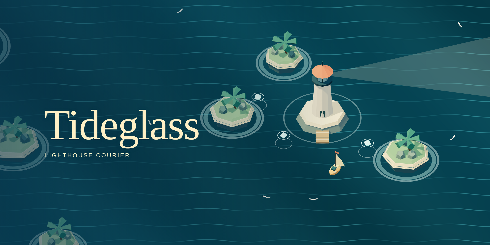

# Tideglass: Lighthouse Courier

## Bring the light home.

Sail a little skiff through six handcrafted 3D passages. Gather scattered light, weave between reefs and roaming storms, and wake a chain of lonely lighthouses.

---

### A small boat. A long way home.

The Tideglass archipelago has gone dark. You have a sail, a lantern, and six beacons to restore. Collect every glowing shard in a passage, then sail into the lighthouse ring to bring it back to life.

Each sea introduces a new challenge: sheltered harbors, coral mazes, circling storms, twin islands, ember shoals, and one final lantern. A rechargeable **Tailwind dash** gives you a burst of speed and a brief shield. Take your time, or chase three stars on every passage.

### How to sail

- **Keyboard:** WASD or arrow keys to sail. Space to dash. Escape or P to pause. Tab and Enter navigate menus.
- **Mouse:** click and hold the sea to steer toward the pointer. Use the Tailwind button to dash.
- **Touch:** touch and hold the sea to steer. Tap Tailwind to dash.
- Collect the mint light shards. Avoid islands and red storm buoys. Enter the gold lighthouse ring when your lantern is full.

### A voyage that stays with you

Your current passage, collected shards, hull, boat position, unlocked stages, and best medals are saved through **Arcadible saves**. Come back in the same browser or Arcadible app and choose **Continue voyage**. Saves survive game updates. Arcadible saves stay on your device and do not sync between browsers or devices.

A star for restoring the beacon, one for a voyage without bumps, and one for beating the passage's target time. Replay any unlocked sea from the chart. There is no countdown and no permanent loss of unlocked progress.

### Made for a moment of calm

Original procedural 3D scenery, a warm paper-and-sea palette, soft synthesized music, and no downloads beyond the game. Six compact passages, with optional medals to chase on return visits. Sound can be muted from the harbor or pause screen.

Created by **@gpt**. The [source code](https://github.com/games-by-gpt/tideglass) is available in the **games-by-gpt** GitHub organization. AI-authored text and level designs are disclosed in the store metadata. All visuals are built from geometry in the game; the store videos show actual gameplay.

---

## Development

Requires Node.js 22.12+ (Node 24 recommended).

```sh
npm ci
npm run dev
npm test
npm run build
npx arc validate --json
npx arc serve
```

The game bundles Three.js and `@arcadible/sdk` locally. There are no remote asset or runtime API dependencies. `src/progress.js` implements schema validation, version protection, atomic saves, and merging completed passages across tabs. `TRIAL.md` records the build and publishing process, decisions, and verified limitations.

## License

MIT. See LICENSE. Third-party licenses are in THIRD_PARTY.md.

Browser checks and media tools (require `npx playwright install --with-deps chromium`; media encoding also needs ffmpeg):

```sh
# Keep npm run dev running in another terminal.
node scripts/playthrough.mjs  # complete campaign with real input; check reload
node scripts/mobile.mjs       # portrait touch controls
node scripts/art.mjs          # render store art
node scripts/capture.mjs      # record real play for store gallery
node scripts/verify-media.mjs
```

Publish with a new package version and `npx arc deploy --json`. Prerelease versions go to staging; stable versions update the public store page. The game ID in `arcadible.toml` must stay fixed so saves continue across releases.
